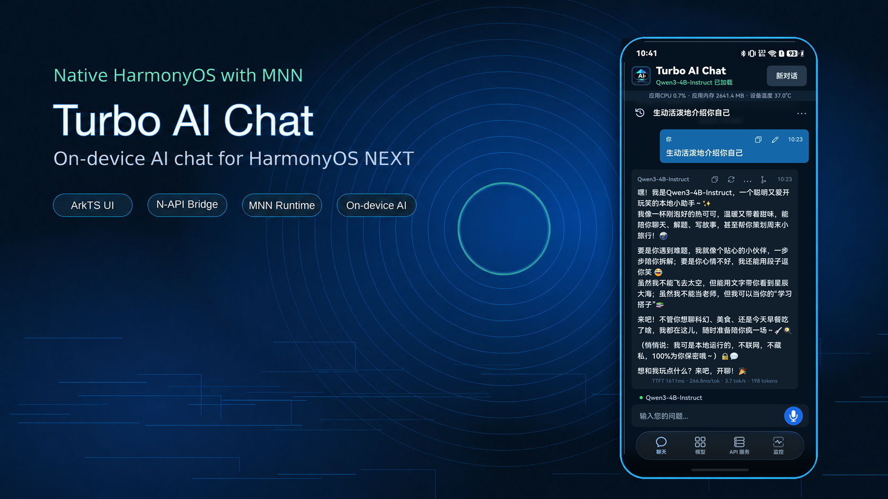
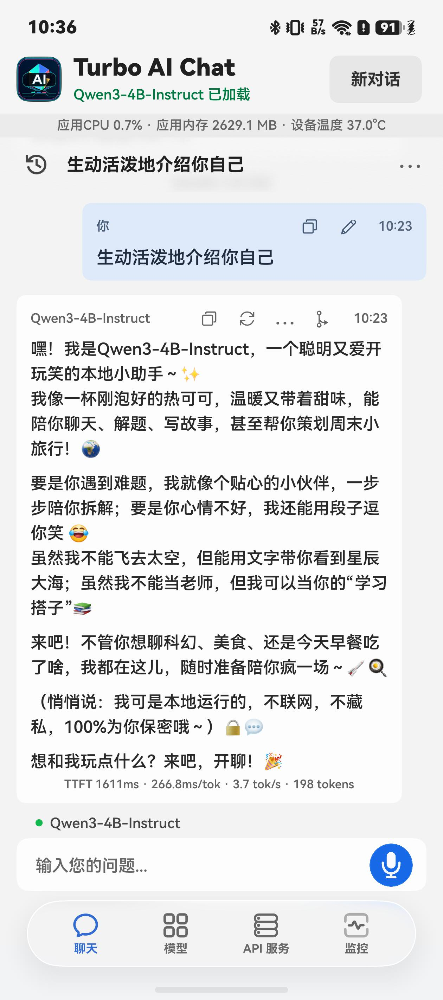
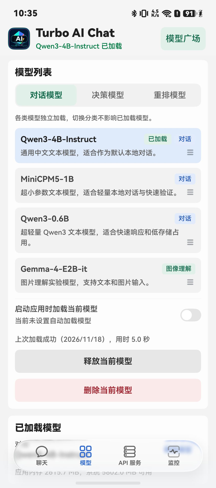
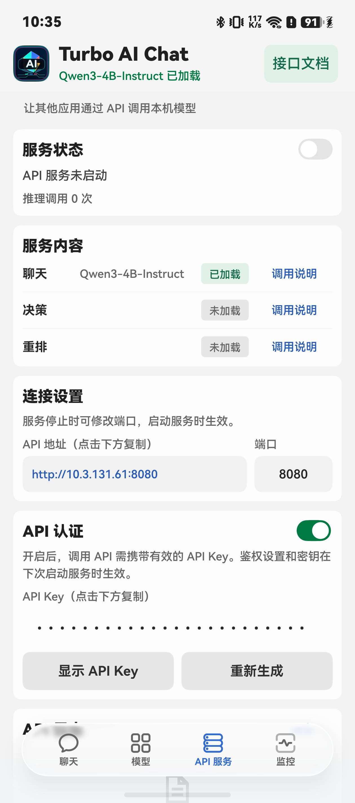
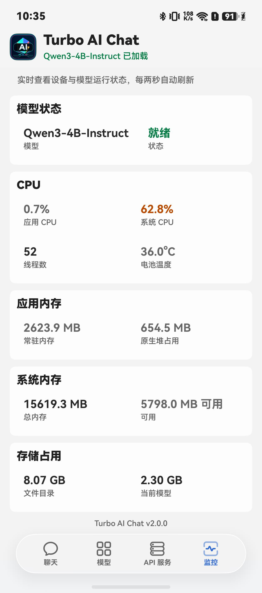
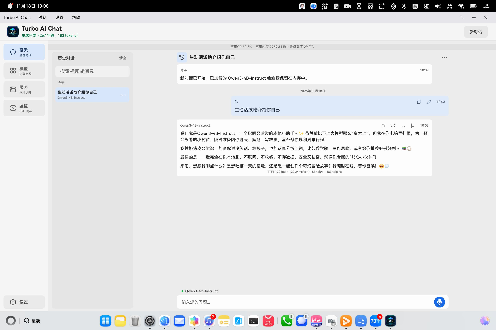
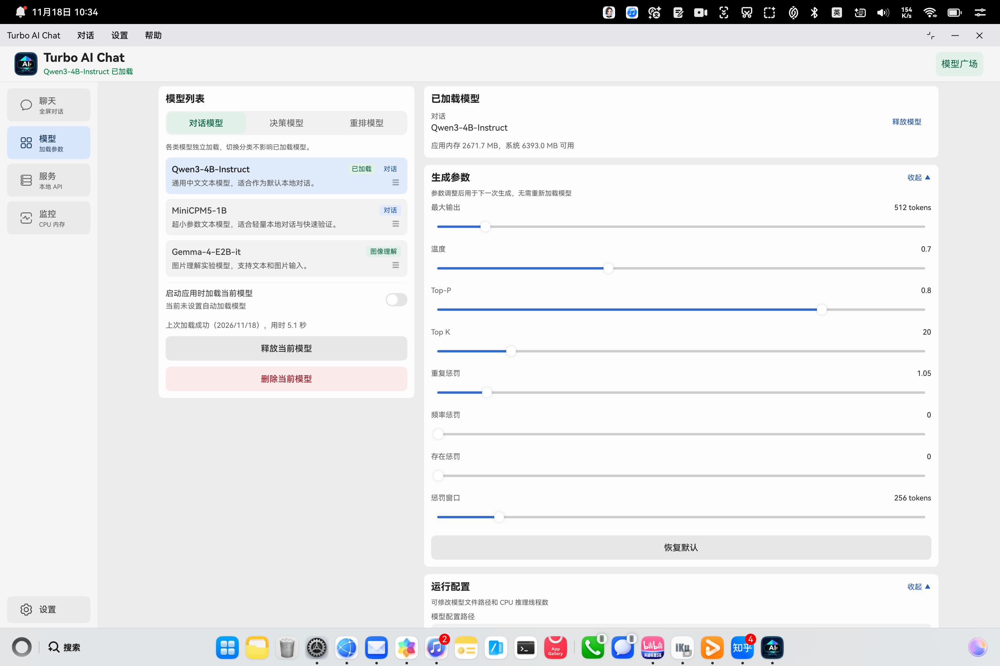
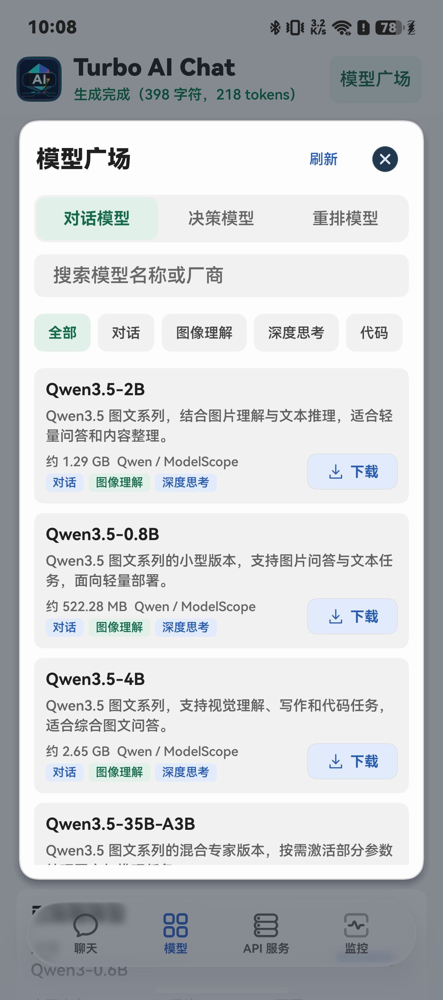
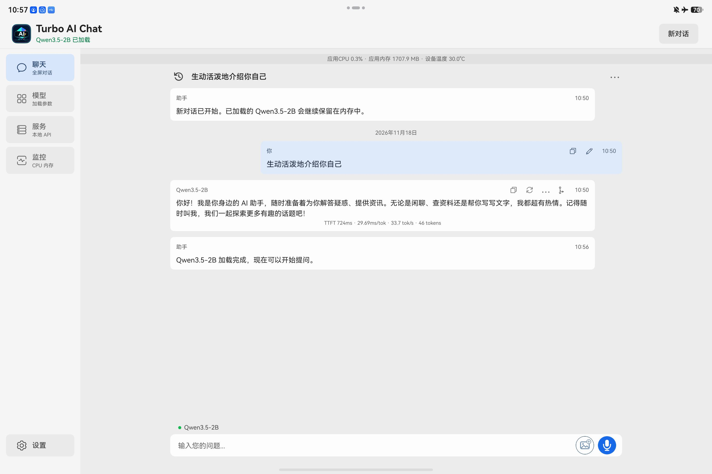
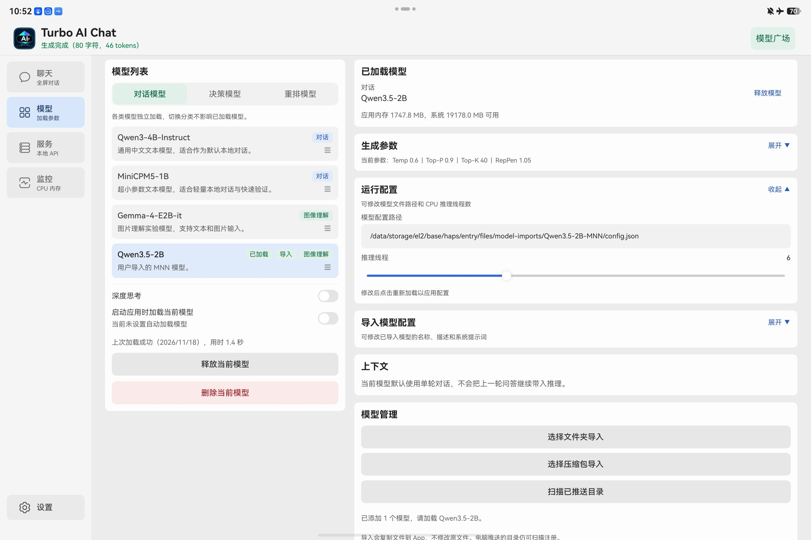

# Turbo AI Chat

[中文](README.md) | English




**Turbo AI Chat is a HarmonyOS NEXT native on-device LLM chat application** that runs text and multimodal models locally on HarmonyOS phones, tablets, and PCs. It is built with ArkTS, C++ N-API, and MNN Runtime, ships profiles for Qwen3-4B-Instruct, MiniCPM5-1B, and Gemma-4-E2B-it, and can add compatible MNN models through the Model Gallery or local import. The app also includes streaming chat, model switching, image understanding, runtime monitoring, and an OpenAI-compatible LAN API.

> This version is built on MNN development snapshot [`f0b6105c`](https://github.com/alibaba/MNN/commit/f0b6105c5c7f901b1531dd4c23afa8a00b454db3). Use the build scripts described below when compiling the runtime yourself.

The project includes [MNN compatibility patches](third_party/mnn/patches/README.md) for text and streaming compatibility, model-load validation, runtime thread reporting and generation-setting updates. The build scripts apply these patches automatically.

## Table of Contents

- [Project Origin and Evolution](#project-origin-and-evolution)
- [Background](#background)
- [Recent Highlights](#recent-highlights)
- [System Requirements](#system-requirements)
- [Quick Start](#quick-start)
- [Features](#features)
- [Screenshots](#screenshots)
- [OpenAI-Compatible API Server](#openai-compatible-api-server)
- [Install from HAP](#install-from-hap)
- [Model Management](#model-management)
- [Model Format](#model-format)
- [Inference Backend and Performance](#inference-backend-and-performance)
- [Architecture](#architecture)
- [Native API](#native-api)
- [Development checks](#development-checks)
- [License](#license)
- [Acknowledgments](#acknowledgments)

## Project Origin and Evolution

This project started from [Turbo1123/turbo-ai-chat-harmonyos](https://github.com/Turbo1123/turbo-ai-chat-harmonyos). The upstream repository's first two commits established an on-device ArkTS → N-API → C++ → MNN inference pipeline with Gemma 4 text generation, streaming output, and multi-turn conversation, providing a working foundation for subsequent development.

While retaining that foundation, this repository gradually expanded the Gemma 4-oriented implementation into a general inference path for compatible MNN model directories. It completed the image-input path from ArkTS to MNN and added generation control, stop reasons, token statistics, model-directory validation, and lifecycle management. At the application layer, subsequent work added model switching and import, the online Model Gallery, offline voice input, runtime monitoring, and an OpenAI-compatible LAN API.

The repository has since left the original fork network and is now maintained independently, while preserving the upstream commit history, Apache-2.0 license, and source attribution. See [Core Inference Pipeline Evolution](docs/architecture/core-inference-evolution.md) for the upstream baseline, implementation changes, and corresponding commits, and [`MODIFICATIONS.md`](MODIFICATIONS.md) for file-level modification notices. The complete code difference is available at [`f946a84...main`](https://github.com/Torry2022/turbo-ai-chat-harmonyos/compare/f946a842...main).

## Background

Turbo AI Chat runs models locally on HarmonyOS devices through a native inference pipeline (ArkTS → N-API → MNN → CPU):

- **Native architecture**: inference directly via HarmonyOS NDK, no Android compatibility layer overhead
- **Easy model installation**: download preset models from ModelScope through the Model Gallery without separately accessing HuggingFace
- **Reusable engineering**: MNN Runtime wrapper, streaming pipeline, Markdown rendering as integration references for other HarmonyOS AI apps

The project can serve as a development and integration reference for local AI applications on HarmonyOS.

## Recent Highlights

**Model downloads and chat model speed testing (v2.2.0)**

- **Download tasks.** Check download progress from other tabs and resume unfinished downloads from the floating button after reopening the app.
- **Quick speed test.** Use a fixed prompt to test the currently loaded chat model from the Models page and see time to first output, generation speed, and the app’s peak sampled resident memory.
- **Model Gallery.** Compare download sizes for H2O-Lightning-4B INT4 and INT8. The Models page and Model Gallery use the same category tabs.

**Embedding models and text embeddings API (v2.1.0)**

- Run embedding models on your device to turn text into vectors for semantic search, text similarity and related applications.
- Download and load an embedding model from the Model Gallery, then provide text embeddings to other apps through the OpenAI-compatible API, with batch processing support.

**Conversation management and local inference (v2.0.0)**

- **Export, backup and restore.** Export conversations as Markdown or ZIP files with images. Full-history backups preserve images, every answer version and branch origins.
- **Conversation branches.** Create an independent conversation from an assistant answer, retain its history and return to the source conversation.
- **Context management and inspection.** Inspect the messages included in each answer and why others were omitted. Use the model's declared context limit to trim older complete exchanges and reserve space for the reply.
- **Multi-turn image conversations and API input.** Ask follow-up questions about the original image. The OpenAI-compatible conversation API accepts image inputs and remote image URLs.
- **KV cache reuse and interrupted answers.** Reuse matching history in consecutive text conversations to reduce repeated prefill. Preserve generated text after stopping, timeout or output-limit termination for later questions.
- **Run details and model management.** Inspect and export generation settings, model source, effective threads and timings for each answer version, and retrieve inference records through the runtime API. View loaded models, loading records and process memory, with individual release controls.
- **Downloads and resource optimization.** Resolve complete model revisions before downloading, improve file validation and failure messages, and resume interrupted downloads. Improve background task management on supported devices and reduce H2O-Lightning loading memory and storage requirements.
- **Interface improvements.** Scroll truncated history titles on mouse hover, clarify model sources and disabled actions, and improve phone conversation headers and startup system-bar coverage.

**Decision models and runtime settings (v1.22.0)**

- Download H2O-Lightning INT8 from the Model Gallery for text and image choice, score and boolean tasks through the trial dialog or API.
- Use consistent CPU thread controls and Reload actions for chat, decision and reranking models. The range follows the device logical CPU count, capped at 16, with clear feedback on when settings take effect.
- Identify loaded models by full names and status tags, with single-line scrolling for long names and simpler decision and reranking setup.
- Fix template recognition for thinking controls, reduce state updates and parsing work while scrolling chats, and preserve document order when copying across text blocks.
- Use blue selection accents in phone navigation.

<details>
<summary>Earlier releases</summary>

**Startup presentation (v1.21.1)**

- Brighten the background linearly and fade smoothly into the main interface.
- Use dedicated artwork in landscape windows, keeping the light ring intact and extending the light trails to both sides.

**Streaming display and legacy model compatibility (v1.21.0)**

- Reveal generated text progressively with a brief fade-in, steadier Markdown updates and stable code-block alignment.
- Coordinate phone keyboard transitions with the chat position and resume following when scrolling back to the bottom. Retain normally completed replies in subsequent context and clear the first question's draft after sending.
- Recognize supported legacy ChatML templates, filter out non-conversation models and explain known package configuration problems before downloading weights.

**Official model catalogs and thinking controls (v1.20.0)**

- Browse the official MNN conversation catalog and ModelScope Qwen3-Reranker listings, with supplemental catalogs and offline caches. Filter by capability and use two-column cards in wide windows.
- Turn deep thinking on or off for supported models, including imported models with compatible templates. Choices are saved per model and apply to the next request.
- Read model summaries based on official sources, updated and cached through a separate online file. New entries retain default descriptions until a curated summary is available.

**Image previews and multimodal chat (v1.19.0)**

- Preview images before sending and open message attachments full-screen with pinch zoom, double-tap zoom and panning.
- Preserve and clean up attachments consistently across saves, edits and interrupted copies. Fix image preprocessing for legacy Gemma 4 packages and apply the configured thread count to multimodal inference.
- Refine Model Gallery cards, filters and catalog refresh, and keep header status text scrolling during monitoring updates.

**Chat history saving and recovery (v1.18.3)**

- Complete history writes before replacing saved records and preserve existing data on failure. Recover the last selected conversation from a valid backup when the history index is missing or damaged.

**Model settings and service feedback (v1.18.2)**

- Separate reranking model management from runtime settings, with consistent section animations and pending thread-change indicators.
- Keep interface documentation available during inference, open complete API log entries and distinguish unloaded models, busy requests and service errors.

**Thread configuration and sampling fixes (v1.18.1)**

- Fix earlier model loads limiting later CPU thread counts; chat and reranking models retain their own thread settings.
- Apply sampling changes to the next request, preserve current settings when loading, and use greedy sampling at zero temperature.

**Reranking and API services (v1.18.0)**

- Add a reranking model category to import, load and release compatible Qwen3-Reranker MNN models independently, and rank candidate texts by relevance through `/v1/rerank`.
- Serve chat, decision and reranking endpoints together according to each model's readiness. Keep the API server running when models are changed or released.
- Align model list styling, simplify the service page, and provide model requirements and request examples in the usage dialogs.

**Model compatibility and runtime monitoring (v1.17.0)**

- Update MNN for newer text and multimodal models and preserve model-defined markers in streaming output.
- Show an indeterminate shimmer bar and actual loading time, and correct the image attachment badge fill in both themes.
- Add a runtime status API available during generation and use RSS consistently in the Monitor page and chat memory indicator.

**Answer versions and history search (v1.16.0)**

- Retain earlier answers when regenerating and switch versions within the bubble. Follow-up questions use the selected answer as context, and history search can locate earlier versions.
- Show compact header tags for stopped, interrupted, timed-out, or output-limited answers, retaining each version's status. Give the wide history sidebar a subtle background and rounded corners.
- Improve automatic naming with context from both ends of long questions and better English titles. Keep the chat heading and history list in sync after naming.

**Conversation naming and sidebar refinements (v1.15.0)**

- Generate titles with the loaded model when idle after the first reply. Questions and model changes take priority, and manual names are preserved.
- Refine wide-window history placement, width, spacing and rename buttons, and align the settings button with the composer while tightening message spacing on tablets and PCs.

**Chat history and on-device decisions (v1.13.0)**

- Save and manage conversations locally, retaining reply models and model-switch records.
- Use Laya for local choice, scoring, and yes/no decisions, including through `/v1/decisions`.
- Expand long drafts in place; select across Markdown blocks on API 26 or later.
- Use the official immersive phone tab bar on API 26 or later; new installations follow the system appearance.

**Navigation and model import improvements (v1.12.0)**

- Add icons to mobile navigation and sidebars, retaining descriptions in wide sidebars. Use a theme-aware blurred mobile navigation background with adjusted bottom content spacing.
- Preserve key identifiers in short names for duplicate imports. Keep unrelated controls stable during directory scans and retain the current selection and edited parameters when no models are added.

**Local model import improvements (v1.11.1)**

- Import models by selecting a folder on supported devices, alongside ZIP import and pushed-directory scanning.
- Add storage checks and stage-specific errors, and refine generated short names while preserving existing names.

**PC menus and chat interactions (v1.11.0)**

- Add Chat, Settings, and Help menus to the PC title bar, with hover switching, keyboard shortcut help, and an About dialog.
- Keep the current model name and status indicator above the chat input. Clicking the input area without a loaded model opens the model page.
- Support copying selected message text, with PC right-click copying respecting the selection. Refine send/microphone button transitions and startup presentation.
- Show an illustrated empty state and a filter reset action when no models match in the Model Gallery. See the [parameter sourcing notes (Chinese)](model-catalog/generation-defaults.md) for model defaults.

**Runtime and model compatibility (v1.10.1)**

- Expand MNN model compatibility and fix attention-mask and repeated text-request issues in some models.
- Show minimum app version requirements in the Model Gallery and prompt users to upgrade before downloading models that their version cannot run.
- Fix generation retries after cancellation and improve microphone permission error messages.
- Improve wide-window bottom layouts: scrolling pages extend to the screen edge, while the chat input and sidebar Settings button stay aligned with bottom spacing and keyboard avoidance.
- Hide bottom navigation while the phone keyboard is open and restore it when dismissed, keeping the input area clear.

**Light theme and appearance settings (v1.10.0)**

- Added Light, Dark, and System appearance options with saved preferences, retaining the original logo and launch artwork.
- Settings is accessible from the sidebar footer in wide windows or the top-left logo menu on phones. Updated page, dialog, model-tag, and metric colors, along with header and bottom-navigation spacing.
- Added transitions when switching tabs and opening or closing dialogs, including Settings. The wide-window monitor displays the model name and status on separate rows to reduce empty space below the card.

**Interface styling (v1.9.1)**

- Retained the existing page layouts while aligning button colors, text, sizes, and corner radii, with consistent input fields and parameter sliders.
- Expanded touch targets for compact actions, reserved space for code-block copy buttons, and fixed clipped refresh-state text in the Model Gallery.

</details>

## System Requirements

| Item | Recommended |
|------|-------------|
| System | HarmonyOS NEXT. The project currently uses `compatibleSdkVersion` `6.1.0(23)` and `targetSdkVersion` `6.1.1(24)` |
| Device | ARM64 HarmonyOS phone, tablet, or PC (`phone` / `tablet` / `2in1`). The emulator is not the target environment for local MNN inference in this project |
| RAM | 8 GB or more is recommended for Qwen3-4B-Instruct / Gemma-4-E2B-it. MiniCPM5-1B and other lightweight models are better suited to devices with less RAM |
| Storage | The HAP is small; model weights dominate storage. A single MNN model directory usually requires several GB |
| Network | In-app model-market installation downloads from ModelScope, so first-time model installation requires ModelScope access |

## Quick Start

> Starting with v2.0.0, this build uses `com.torry.turbochat` and installs separately from the former `com.example.gemma4mnn` app. Its existing models, conversations and settings remain in the old app. This release starts with a fresh data directory.

### 1. Install the app

Download a HAP bundle from [Releases](https://github.com/Torry2022/turbo-ai-chat-harmonyos/releases), extract it and install the HAP on your device. Debug-signed HAPs only work on devices included in their signing profile; other devices need an unsigned HAP signed with your own developer account. See [Install from HAP](#install-from-hap).

<details>
<summary>Build from source</summary>

Install DevEco Studio and the project's HarmonyOS SDK. Open the cloned project, let the IDE synchronize its dependencies, then configure automatic signing with your Huawei developer account and run it on a device.

```sh
git clone https://github.com/Torry2022/turbo-ai-chat-harmonyos.git
cd turbo-ai-chat-harmonyos
```

With the SDK, Node.js, ohpm and signing configured, the command-line equivalent is:

```sh
npm install
ohpm install
node ./node_modules/@ohos/hvigor/bin/hvigor.js assembleHap --no-daemon
hdc install -r entry/build/default/outputs/default/entry-default-signed.hap
```

Model weights are downloaded separately. Rebuilding MNN is optional; see [Inference Backend and Performance](#inference-backend-and-performance).

</details>

### 2. Install models

The app and HAP do not include model weights. Open the app → Model tab → Model Gallery, or select Qwen3-4B-Instruct, MiniCPM5-1B, or Gemma-4-E2B-it and tap load. The app will guide you to download from ModelScope into the app sandbox.

Interrupted downloads resume from verified blocks, with the unfinished block downloaded again. When the model source provides a SHA-256 checksum, the app verifies the completed file before installation. Unverified partial files from older app versions are downloaded again. Installed models remain available.

You can minimize the download window and use the floating button to check progress or pause from another tab. When you reopen the app, unfinished downloads return in a paused state. Tap Continue Download to resume. If the window was minimized when the download finished, the app shows a confirmation and the green checkmark opens the matching model category.

| Model | Size | Capability |
|------|------|------|
| Qwen3-4B-Instruct | ~2.5 GB | Text |
| Gemma-4-E2B-it | ~3.7 GB | Text + Image |
| MiniCPM5-1B (BF16) | ~2.1 GB | Text |

### 3. Start chatting

After the model loads, return to the Chat tab and send a message. Qwen3-4B-Instruct is the default text model. MiniCPM5-1B supports thinking blocks (`<think>`). Gemma-4-E2B-it supports image input.

With a physical keyboard, Enter sends from the chat input and Shift+Enter inserts a line break; the input method handles candidate selection first. Ctrl+N starts a new conversation. Esc leaves the input or closes a dismissible dialog without exiting the app. With the on-screen keyboard, use the send button. Chat content is centered with a maximum width in wide windows; opening the on-screen keyboard reduces the content area while keeping the header and input visible.

## Features

### Conversations and history

- Run text and multimodal models on-device, with streaming Markdown, code blocks, tables and reasoning. Chat offline after installing a model.
- Stop generation, edit questions and regenerate answers. Retain earlier answer versions and use the selected version in follow-up context.
- Preserve generated content after stopping, timeout or output-limit termination, with a status tag in the bubble header. Valid answer text remains available to later questions.
- Save conversations and images locally. Search titles, messages and earlier answer versions. Generate new conversation titles when idle after the first reply, while preserving manual titles.
- Branch from an assistant answer with the history, images and answer versions through that point, and return to the source conversation.
- Export a conversation as Markdown or a ZIP with its images. Back up and restore complete history through Settings, appending restored conversations as independent copies.

### Images and context

- Attach one image per message and preview or remove it before sending. Open message images full-screen with pinch zoom, double-tap zoom and panning.
- Ask follow-up questions about the same image. Each request context supports one image; start a new conversation when changing images.
- Inspect the context used for the latest answer and why messages were omitted. When the model declares a capacity, reserve space for the output and trim older complete exchanges first.
- Toggle deep thinking for supported models, with a per-model choice applied to the next generation. Text conversations can reuse matching context caches.

### Models and runtime settings

- Browse conversation, decision, embedding and reranking models in the Model Gallery, with independent loading and management. Conversation models also support folder, ZIP and pushed-directory imports.
- Adjust CPU threads for all four categories and reload to apply runtime changes. Generation parameters and thinking settings take effect on the next generation.
- View local loading records, loaded models and current memory on the Models page. Release models individually and select a conversation model to load at startup.
- Try choice, score and boolean tasks in the decision dialog or through the API. Use reranking models through the API to rank candidate passages.

### Input, copying and adaptive layouts

- Use the app on phones, tablets and PCs with window-adaptive layouts and Light, Dark or System appearance. Phone conversation headers use native background blur.
- Dictate in Mandarin offline and expand long drafts for editing. Physical keyboards support Enter to send, Shift+Enter for a new line, Ctrl+N for a new conversation and Esc to close dismissible windows. Input-method candidate selection takes priority.
- Copy selected message text across Markdown blocks on API 26 or later. Selections copy visible text, bubble copy preserves Markdown and code-block buttons copy code only.
- Hover over truncated history titles to scroll them into view and double-click the conversation title to rename it. Wide windows provide a history sidebar and PC menus.

### APIs and runtime monitoring

- Expose an OpenAI-compatible LAN chat API, plus decision, embedding, reranking and runtime endpoints, with streaming and optional Bearer authentication.
- View CPU, RSS resident memory, temperature and other metrics in the chat status bar and Monitor page. Inspect and export the model source, threads, generation settings and timings saved with each answer version.
- Content diagnostics are off by default and can be enabled temporarily in Settings. Turning them off, restarting the app or deleting a conversation clears the record. See [Development checks](#development-checks).

## Screenshots

Phone screenshots from v2.0.0 in Light mode:

<table width="100%">
  <tr>
    <th width="25%">Chat</th>
    <th width="25%">Models</th>
    <th width="25%">API Service</th>
    <th width="25%">Monitor</th>
  </tr>
  <tr>
    <td width="25%"></td>
    <td width="25%"></td>
    <td width="25%"></td>
    <td width="25%"></td>
  </tr>
</table>

Maximized PC window, captured full-screen:



<details>
<summary>PC model settings and the phone Model Gallery</summary>





</details>

<details>
<summary>Tablet landscape conversation and model settings</summary>

v2.0.0 in Light mode, captured on a MatePad Edge.





</details>


## OpenAI-Compatible API Server

On the Service page, set the port and optionally enable the app-generated API key, then start the server. The page shows a LAN address such as `http://192.168.1.126:8080`. Chat, decision, embedding and reranking endpoints share this address without switching service modes. Load the corresponding model before using an inference endpoint. Switching or releasing a model leaves the server running; requests report when their model is unavailable.

When adding an OpenAI-compatible provider in Cherry Studio, enter the displayed base URL without appending an endpoint. If API-key authentication is enabled, enter the same key, then fetch the model list. The server provides:

- `GET /v1/models`
- `POST /v1/chat/completions`
- `POST /v1/responses`
- `POST /v1/decisions`
- `POST /v1/rerank`
- `POST /v1/embeddings`
- `GET /turbo/runtime`

Inference requests are handled one at a time. While busy, the server returns HTTP 409 without queuing the request; model-list and runtime queries remain available.

The service header provides an endpoint reference. Click a log entry to view and copy its full text. The service list shows the models currently loaded in memory and marks unloaded categories as “未加载” (Not loaded).

The phone bottom bar and narrow sidebar label this entry “API 服务” (API Service). The wide sidebar uses “服务” (Service) with the “本地 API” (Local API) subtitle.

The Service tab shows operational logs for server lifecycle, request paths, model parameters, response status, latency, and output size. It does not log API keys, prompts, or response text.

Wide windows place service settings beside the API logs. Narrowing the window restores a single column without restarting an active server.

<details>
<summary>Image input, protocol limits and background operation</summary>

The server keeps at most 16 connections. Each request must be received within 15 seconds of connecting and must fit within 1 MiB. A send that stalls for 30 seconds, or more than 4 MiB of pending output, closes the connection and requests cancellation of its chat or reranking task. The receive deadline does not limit normal model inference time.

On PCs and 2-in-1 devices, an active API service or model task requests a system background computation task and releases it when finished. The system displays a corresponding notification. In the background, the app also attempts to reduce power-saving restrictions on computation, restoring the default policy when the task ends or the app returns to the foreground. System scheduling can still make background inference substantially slower than foreground inference. Background computation on regular phones and tablets requires additional system authorization, so inference and API use currently require keeping the app in the foreground. Model downloads use an independent background data-transfer task, released when paused or finished. Switching away saves a conversation checkpoint and returning preserves the current state.

Image conversations support follow-up questions about the same image. History is trimmed to the model's context capacity. Each request context supports one image. Start a new conversation when changing images. Images are saved with their original messages so conversations can be reopened and continued.

The chat API accepts text and image input, serves the currently loaded chat model, and processes one generation request at a time. For models that emit `<think>`, `/v1/chat/completions` returns reasoning in `reasoning_content`, while `/v1/responses` returns a separate reasoning output item; the final answer remains in the regular text field. Non-streaming Chat Completions reports runtime-measured input and output token counts in `usage`. Streaming requests can set `stream_options.include_usage: true` to receive a final usage chunk. When counts are unavailable or output tokens are estimated, non-streaming Chat Completions omits `usage` and the streaming usage chunk reports null. Responses returns `usage: null` when its count breakdown is incomplete, including responses with reasoning output. The server runs with the app and stops when the app exits. The device and client must be reachable on the same LAN.

With an image-capable model loaded, `/v1/chat/completions` accepts `text` and `image_url` parts in a user message's `content` array. `/v1/responses` uses `input_text` and `input_image`. Supply a PNG, JPEG or WebP Base64 Data URL, or a directly accessible public HTTP/HTTPS URL. Each request supports one image. Clients must include the original image and message history for follow-up questions. Remote images are limited to 10 MiB, a 30-second download and three redirects. Source images must not exceed 40 million pixels. The existing 1 MiB request-body limit still applies, so use a URL for larger images. Input token counts include both images and text. When the model configuration declares a context capacity, oversized API requests return an explicit error and the app trims older complete exchanges first. Capacity is reported as unknown when the model package does not declare it.

Example user message

```json
{
  "role": "user",
  "content": [
    { "type": "text", "text": "Summarize this image." },
    { "type": "image_url", "image_url": { "url": "https://example.com/image.png" } }
  ]
}
```

At the output limit, Chat Completions returns `finish_reason: length`, while Responses returns `status: incomplete` with the `max_output_tokens` reason. Cancellation, timeout, and generation failure return explicit errors. Failed Responses streams end with `response.failed`.

| Capability | Support |
| --- | --- |
| Text messages, streaming, output limits, temperature, Top-P | Supported |
| Separate reasoning and answer output | Supported |
| Tool calls, JSON mode, JSON Schema | Rejected with an explicit unsupported-feature error |
| Responses history IDs, server-side conversations, background tasks and storage | Rejected with an explicit unsupported-feature error |
| Custom stop sequences, seeds and multiple completions per request | Not currently supported |

</details>

### Runtime status

`GET /turbo/runtime` exposes CPU, memory, temperature, threads, storage and chat-model state using the same server authentication. It remains available during generation without opening the Monitor page. It also exposes the latest API chat generation configuration and timings without conversation content. Numeric fields have explicit units and sample timestamps; see the [runtime API reference](docs/runtime-api_EN.md). Both the Monitor page and chat memory indicator use RSS (resident memory).

### Embeddings API

Select “向量” (Embeddings) on the Models page, download a model from the Model Gallery and load it before calling `POST /v1/embeddings`. Sources include the official MNN catalog and the supplemental BGE-small-zh-v1.5 package.

`input` accepts one string or an array of up to 64 strings, with at most 512 tokens per string. The response contains floating-point vectors in input order and actual input token counts in `usage.prompt_tokens`. Vector dimensions depend on the model. The supported encoding format is `float`.

```json
{ "input": ["Local semantic search", "Convert text to vectors"], "encoding_format": "float" }
```

### Decision API

Select and load a model in the Decision Model category, then call `/v1/decisions`. One decision model can be loaded at a time. Release it before switching to another. Chat, decision, and reranking models are managed separately while the API server remains running.

Download Laya and H2O-Lightning from the Decision Models category in the Model Gallery, then select and load them on the Model page. Choose between H2O-Lightning INT4 and INT8 to see each package's download size and installation status.

H2O-Lightning supports model packages retaining only the 255 candidate-label outputs to reduce loading memory. The package's output format must match the decision wrapper. See the [H2O decision wrapper](scripts/h2o/README_EN.md) for conversion instructions.

`POST /v1/decisions` supports `choice`, `score`, and `boolean` tasks. Omit `model` to use the loaded decision model, or supply its ID from `GET /v1/models`. H2O-Lightning also accepts an optional `image` field containing a PNG, JPEG, or WebP Base64 data URI. Its trial dialog provides an image picker. The complete request body is limited to 1 MiB. Returned candidate probabilities preserve each model's calculation rules and numeric precision. H2O responses include the actual input token count in `metadata.input_tokens`, including the prompt template and options. `metadata.cpu_threads` reports the verified runtime CPU thread count. Decision-model threads can be adjusted under Runtime Configuration on the Model page. Changes take effect when the model is reloaded. Scores are probability-weighted expected levels. The Service page's API Guide includes request examples.

## Install from HAP

[Releases](https://github.com/Torry2022/turbo-ai-chat-harmonyos/releases) provide signed HAPs (only for devices included in the current profile). Install via hdc:

Each Release also provides a ZIP containing the HAP, `LICENSE`, and `NOTICE`. Extract the ZIP before installing its HAP. Packages do not include model weights.

```sh
hdc install -r turbo-ai-chat-harmonyos-vX.Y.Z-signed.hap
```

You can also sideload the HAP with [Xiaobai Debug Assistant](https://github.com/likuai2010/auto-installer). Debug-signed packages only work on devices included in the current profile; for other devices, download the unsigned HAP and re-sign it with your own developer account.

## Model Management

Download a reranking model from the Model Gallery and load it under Models → Reranking models to score candidate passages through [`/v1/rerank`](docs/rerank-api_EN.md). The endpoint shares the chat server address and authentication.

The recommended path is to install models from the in-app Model Gallery. Conversation models also support folder and ZIP imports, or a complete directory pushed through hdc for large models.

- **Model Gallery**: browse and download conversation, decision, embedding or reranking models, starting in the category selected on the Model tab. Cards use two columns in wide windows and one column on phones and in narrow windows. Conversation and embedding models come from the official MNN gallery, with bge-small-zh-v1.5 retained as a supplemental embedding source. Qwen3-Reranker models come from the MNN organization on ModelScope, and Laya and H2O-Lightning are provided for decisions. The conversation catalog filters out embedding, safety-classification, pretrained completion and other non-conversation models. Package versions with confirmed configuration problems are rejected with an explanation before weights are downloaded. Before downloading weights, the app validates the configuration and pins the file revision. Cached and bundled catalogs remain available offline. Capability tags support filtering; they do not mean every listed model has been tested in this app on a device. Card summaries update from a separate online description file and are cached with the gallery; models without a curated entry keep their default description.
- **Folder import**: select a complete MNN model directory through the system picker. The app checks available storage, then copies and validates the files without changing the source directory. If the picker cannot open, retry or use zip import.
- **Zip import**: select a ZIP containing a complete MNN model directory. The app checks space for the staging copy; extraction needs additional space. Error messages identify the failed stage: copying, extraction, validation, or saving. The app does not impose a 2 GB limit, but large imports still depend on system support and available storage.
- **Manual directory push**: useful for large models, offline imports, or when zip import fails; push the directory and scan it from the Model tab.

### Manual Model Push

Use the following `hdc` commands to import a complete model directory from a computer.

The model directory must be in **MNN format** — exported via MNN `llmexport.py` from HuggingFace weights, containing `config.json`, `llm_config.json`, tokenizer file, `llm.mnn`, `llm.mnn.weight`, etc. Original HuggingFace safetensors, GGUF, and MLX weights cannot be used directly.

#### Pushing built-in model directories

Use the following commands to restore built-in model directories when in-app download is unavailable:

```sh
cd models
hdc file send -b com.torry.turbochat gemma-4-E2B-it-MNN /data/storage/el2/base/haps/entry/files/
hdc file send -b com.torry.turbochat MiniCPM5-1B-MNN /data/storage/el2/base/haps/entry/files/
hdc file send -b com.torry.turbochat Qwen3-4B-Instruct-2507-MNN /data/storage/el2/base/haps/entry/files/
```

> The `-b` flag specifies the bundle name and is required to write into the app sandbox.

#### Registering a pushed model as an import

To register a pushed model as an imported model:

1. Prepare a complete MNN model directory. It should contain `config.json`, `llm_config.json`, `llm.mnn`, `llm.mnn.weight`, tokenizer files, and related metadata.
2. The example below uses `models/Qwen3-4B-Instruct-2507-MNN`. The model can also be stored elsewhere; run the push command from its parent directory.
3. Run `hdc file send` from the parent directory of the model directory:

   ```sh
   cd models
   hdc file send -b com.torry.turbochat Qwen3-4B-Instruct-2507-MNN /data/storage/el2/base/haps/entry/files/model-imports/
   ```

4. Verify the directory on the device:

   ```sh
   hdc shell "ls -la /data/app/el2/100/base/com.torry.turbochat/haps/entry/files/model-imports/Qwen3-4B-Instruct-2507-MNN"
   ```

   The directory should contain `config.json`, `llm_config.json`, `llm.mnn`, `llm.mnn.weight`, and tokenizer files.

5. Open the app → Model tab → expand "Model Management".
6. Tap "Scan pushed directory". The app checks the configuration, weights, and chat template, then adds compatible models to the list.
7. Select the new imported model from the model list and load it.

For folder import, zip import, and directory scanning, the app reads `is_visual` from `llm_config.json` to detect image capability automatically. The app generates a short display name, preserving key identifiers such as the model generation, parameter size, variants like `VL`, and quantization markers where possible. Existing names are preserved; clear the short-name field in the imported model settings and save to regenerate it.

The scanner only checks first-level subdirectories under `model-imports/`. Directory names must not contain `/`, `\`, or `..`. On Windows, run `hdc file send` from the parent directory of the model directory to avoid preserving extra parent paths or writing backslashes into the app sandbox. If your model is not under the repository `models/` directory, `cd` to that model directory's parent before pushing.

The app checks chat templates when downloading from Model Gallery, installing preset models, and scanning imports. It uses the model configuration's `jinja.chat_template` when available. For older packages with complete standard ChatML role templates or a recognized ChatML prompt template, it adds the corresponding Jinja template automatically. Unrecognized formats are reported as incompatible; add the model's own Jinja template before importing again.

## PC-side Model Download Scripts

```sh
# Qwen3-4B-Instruct (~2.5 GB)
./scripts/download_qwen3_4b_mnn.sh

# Gemma-4-E2B-it (~3.7 GB)
./scripts/download_gemma4_e2b_mnn.sh

# MiniCPM5-1B BF16 (~2.1 GB)
./scripts/download_minicpm5_1b_mnn.sh
```

Specify an output directory:

```sh
./scripts/download_minicpm5_1b_mnn.sh /path/to/MiniCPM5-1B-MNN
```

Requires the Python modelscope package: `pip install modelscope`.

## Model Format

The app uses **MNN model directory** format. Built-in models are downloaded from ModelScope: Qwen3-4B-Instruct and Gemma-4-E2B-it from the [MNN organization](https://modelscope.cn/organization/MNN), MiniCPM5-1B BF16 from [TorryJi](https://modelscope.cn/models/TorryJi/MiniCPM5-1B-MNN-BF16). Original HuggingFace weights must be converted via MNN `llmexport.py` before use.

## Inference Backend and Performance

On the Models page, open the speed test in the Loaded Models card to test the currently loaded chat model with a fixed prompt. The results show prefill time, time to first output, decode time, and the app’s peak sampled resident memory.

The current version runs local inference with the **MNN CPU backend**. GPU / NPU backends are not integrated yet. All three model categories offer CPU inference thread controls under Runtime Configuration. The range starts at 1 and ends at the device’s logical CPU count, capped at 16. Chat and reranking default to 6; decision models default to 4. All three categories allow settings to be edited while loaded. Select Reload to release and reload the loaded model with the new settings. Generation parameters and thinking settings take effect on the next generation without reloading.

To build MNN yourself, use the pinned commit above with the repository's [PowerShell](scripts/build_mnn_ohos.ps1) or [Shell](scripts/build_mnn_ohos.sh) build script. Specify the source directory with the `-MnnRoot` parameter or the `MNN_ROOT` environment variable, respectively. Build version and patch details are recorded in `BUILD_INFO.json`.

On-device LLM decoding includes token-by-token serial stages, and actual throughput can also be limited by memory bandwidth, cache contention, and system thermal control. In assistant messages, TTFT is the end-to-end time from request submission to the first complete UTF-8 output chunk. TPOT and tokens/s use the interval from the first output callback to completion and the native output-token count. When token counts are estimated by re-tokenizing the output, the count and derived rates are marked as approximate. Evaluate these metrics together with app CPU, app memory, and device temperature.

## Architecture

```text
ChatViewModel / OpenAiApiServer
    |-- GenerationWorkflow / NativeInferenceService
    |-- DecisionService
    `-- RerankerService
                |
       N-API Bridge (libentry.so)
    |-- MnnLlmRunner       text / image
    |-- Laya / H2O         decisions
    `-- MNN Reranker       scoring
                |
       MNN Runtime / CPU Backend
```

The conversation, decision and reranking paths share the MNN CPU runtime. A shared execution permit coordinates model tasks; the models can remain loaded independently. Installation, import, preflight checks and loading records are managed in ArkTS. The local API uses these same runtime paths. See [Core Inference Pipeline Evolution](docs/architecture/core-inference-evolution.md).

## Native API

ArkTS accesses the Native bridge through `libentry.so`. The maintained signatures and result types are in the [type declarations](entry/src/main/cpp/types/libentry/Index.d.ts).

- Conversation generation prepares the actual input, then runs text, raw-prompt or image inference, returning text, stop reasons, token counts and Native timings.
- Laya and H2O provide explicit loading, decision and release operations. Reranking provides loading, scoring, cancellation and release through its service wrapper.
- The bridge also exposes thread information, generation cancellation and diagnostic controls. ArkTS services coordinate execution ownership and model lifecycle.

## Development checks

[Host regression CI](.github/workflows/host-regression.yml) runs on pushes to `main` and pull requests targeting `main`. It covers chat history, automatic titles, message copying, model imports, API state and model catalog tooling. It can also be started manually from the Actions page.

See the [test and acceptance checklist](docs/testing.md) for device scenarios and result recording (Chinese).

These tests run on a host computer with mocked system interfaces and require neither model weights nor a device. ArkTS compilation, HAP builds, signing and device validation still use DevEco Studio.

Content diagnostics can be enabled temporarily in Settings to inspect the latest text request, answer and generation parameters in `raw_output_debug.txt` through hdc. Recording is off by default and is cleared when disabled, on restart or when a conversation is deleted. Image, decision and reranking requests do not record their content.

```sh
hdc shell "cat /data/app/el2/100/base/com.torry.turbochat/haps/entry/files/raw_output_debug.txt"
```

## License

This repository's source code is licensed under Apache-2.0.

MNN Runtime and model weights follow their respective upstream licenses or model-card terms. This repository and Release HAPs do not include model weights. Users who download models through the Model Gallery, scripts, or manual push should follow the terms of the corresponding upstream source.

- [H2O-Lightning-4B-MNN-INT8](https://modelscope.cn/models/TorryJi/H2O-Lightning-4B-MNN-INT8)
- [Laya-Multilingual-MNN-FP16](https://modelscope.cn/models/TorryJi/Laya-Multilingual-MNN-FP16)
- [MNN](https://github.com/alibaba/MNN)
- [Qwen3-4B-Instruct-2507-MNN](https://modelscope.cn/models/MNN/Qwen3-4B-Instruct-2507-MNN)
- [Gemma-4-E2B-it-MNN](https://modelscope.cn/models/MNN/Gemma-4-E2B-it-MNN)
- [MiniCPM5-1B-MNN-BF16](https://modelscope.cn/models/TorryJi/MiniCPM5-1B-MNN-BF16)
- [MNN-Pocket-0.3B-MNN (INT4)](https://modelscope.cn/models/MNN/MNN-Pocket-0.3B-MNN)

## Acknowledgments

Thanks to Turbo1123 for open-sourcing the original Turbo AI Chat project, which provided the starting point for this application's continued development. [Original repository](https://github.com/Turbo1123/turbo-ai-chat-harmonyos)
