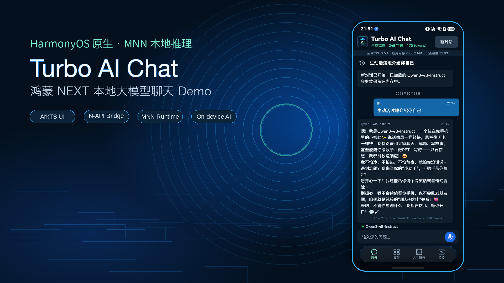
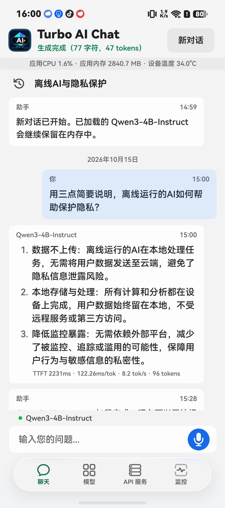
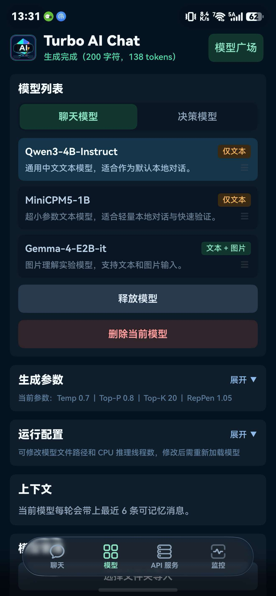
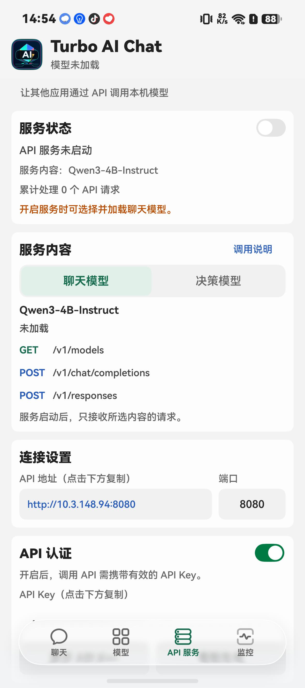
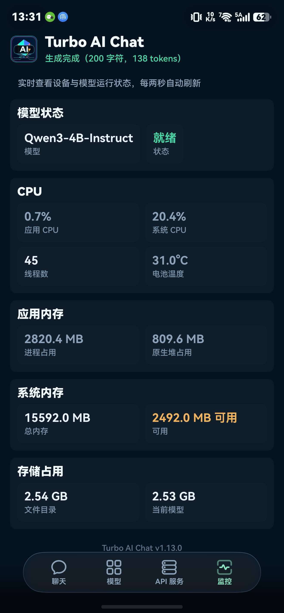
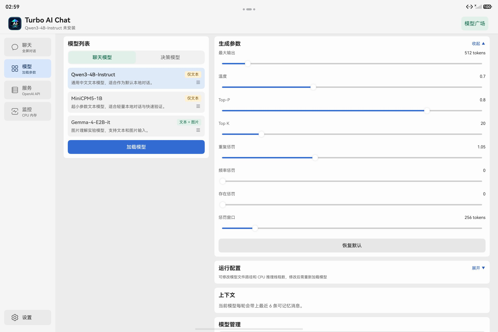
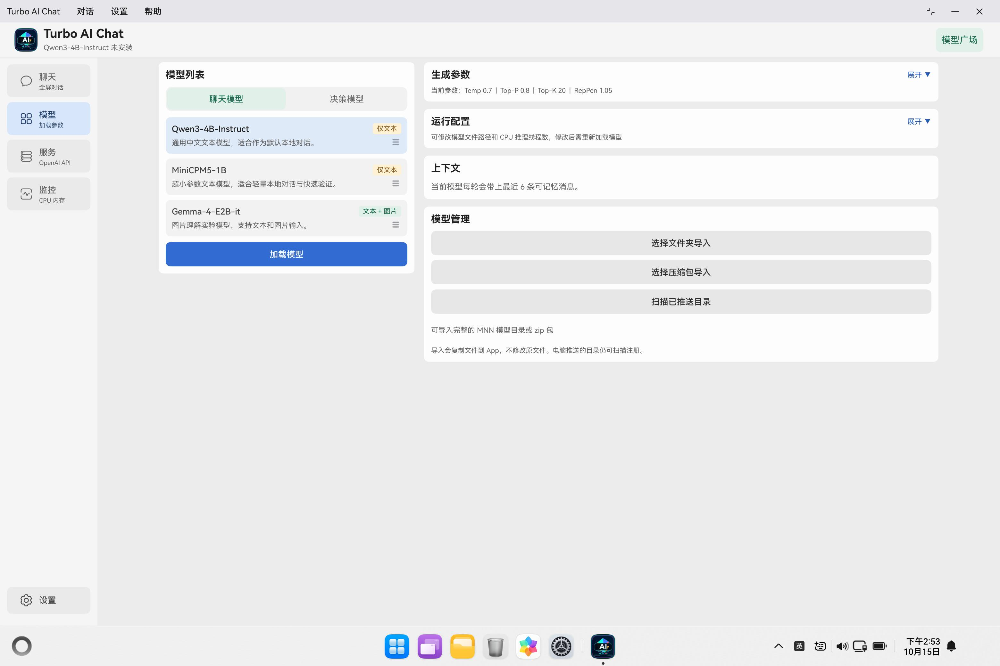

# Turbo AI Chat

[中文](README.md) | English




**Turbo AI Chat is a HarmonyOS NEXT native on-device LLM chat application** that runs text and multimodal models locally on HarmonyOS devices. It is built with ArkTS, C++ N-API, and MNN Runtime, ships profiles for Qwen3-4B-Instruct, MiniCPM5-1B, and Gemma-4-E2B-it, and can add compatible MNN models through the Model Gallery or local import. The app also includes streaming chat, model switching, image understanding, runtime monitoring, and an OpenAI-compatible LAN API.

> This version is built on MNN development snapshot [`f0b6105c`](https://github.com/alibaba/MNN/commit/f0b6105c5c7f901b1531dd4c23afa8a00b454db3). Use the build scripts described below when compiling the runtime yourself.

The project includes two [MNN compatibility patches](third_party/mnn/patches/README.md) for NFC text normalization and preserving model-defined token text in streaming output. The build scripts apply these patches automatically.

## Table of Contents

- [Project Origin and Evolution](#project-origin-and-evolution)
- [Background](#background)
- [Recent Highlights](#recent-highlights)
- [System Requirements](#system-requirements)
- [Quick Start](#quick-start)
- [Features](#features)
- [Screenshots](#screenshots)
- [OpenAI-Compatible API Server](#openai-compatible-api-server)
- [Model Management](#model-management)
- [Model Format](#model-format)
- [Inference Backend and Performance](#inference-backend-and-performance)
- [Architecture](#architecture)
- [Native API](#native-api)
- [Development checks](#development-checks)
- [License](#license)

## Project Origin and Evolution

This project started from [Turbo1123/turbo-ai-chat-harmonyos](https://github.com/Turbo1123/turbo-ai-chat-harmonyos). The upstream repository's first two commits established an on-device ArkTS → N-API → C++ → MNN inference pipeline with Gemma 4 text generation, streaming output, and multi-turn conversation, providing a working foundation for subsequent development.

While retaining that foundation, this repository gradually expanded the Gemma 4-oriented implementation into a general inference path for compatible MNN model directories. It completed the image-input path from ArkTS to MNN and added generation control, stop reasons, token statistics, model-directory validation, and lifecycle management. At the application layer, subsequent work added model switching and import, the online Model Gallery, offline voice input, runtime monitoring, and an OpenAI-compatible LAN API.

The repository has since left the original fork network and is now maintained independently, while preserving the upstream commit history, Apache-2.0 license, and source attribution. See [Core Inference Pipeline Evolution](docs/architecture/core-inference-evolution.md) for the upstream baseline, implementation changes, and corresponding commits, and [`MODIFICATIONS.md`](MODIFICATIONS.md) for file-level modification notices. The complete code difference is available at [`f946a84...main`](https://github.com/Torry2022/turbo-ai-chat-harmonyos/compare/f946a842...main).

## Background

Turbo AI Chat runs models locally on HarmonyOS devices through a native inference pipeline (ArkTS → N-API → MNN → CPU):

- **Native architecture**: inference directly via HarmonyOS NDK, no Android compatibility layer overhead
- **Easy model installation**: download preset models from ModelScope through the Model Gallery without separately accessing HuggingFace
- **Reusable engineering**: MNN Runtime wrapper, streaming pipeline, Markdown rendering as integration references for other HarmonyOS AI apps
- **Diagnostics**: inspect raw inference logs (`raw_output_debug.txt`) through hdc, including input messages or raw prompts, model output, and sampling parameters

  ```sh
  hdc shell "cat /data/app/el2/100/base/com.example.gemma4mnn/haps/entry/files/raw_output_debug.txt"
  ```

The project can serve as a development and integration reference for local AI applications on HarmonyOS.

## Recent Highlights

**Model compatibility and runtime monitoring (v1.17.0)**

- Update MNN for newer text and multimodal models and preserve model-defined markers in streaming output.
- Show an indeterminate shimmer bar and actual loading time, and correct the image attachment badge fill in both themes.
- Add a runtime status API available during generation and use RSS consistently in the Monitor page and chat memory indicator.

**Answer versions and history search (v1.16.0)**

- Retain earlier answers when regenerating and switch versions within the bubble. Follow-up questions use the selected answer as context, and history search can locate earlier versions.
- Show compact header tags for stopped, interrupted, timed-out, or output-limited answers, retaining each version's status. Give the wide history sidebar a subtle background and rounded corners.
- Improve automatic naming with context from both ends of long questions and better English titles. Keep the chat heading and history list in sync after naming.

**Conversation naming and sidebar refinements (v1.15.0)**

- Generate titles with the loaded model when idle after the first reply. Questions and model changes take priority, and manual names are preserved.
- Refine wide-window history placement, width, spacing and rename buttons, and align the settings button with the composer while tightening message spacing on tablets and PCs.

**Chat history and on-device decisions (v1.13.0)**

- Save and manage conversations locally, retaining reply models and model-switch records.
- Use Laya for local choice, scoring, and yes/no decisions, including through `/v1/decisions`.
- Expand long drafts in place; select across Markdown blocks on API 26 or later.
- Use the official immersive phone tab bar on API 26 or later; new installations follow the system appearance.

**Navigation and model import improvements (v1.12.0)**

- Add icons to mobile navigation and sidebars, retaining descriptions in wide sidebars. Use a theme-aware blurred mobile navigation background with adjusted bottom content spacing.
- Preserve key identifiers in short names for duplicate imports. Keep unrelated controls stable during directory scans and retain the current selection and edited parameters when no models are added.

**Local model import improvements (v1.11.1)**

- Import models by selecting a folder on supported devices, alongside ZIP import and pushed-directory scanning.
- Add storage checks and stage-specific errors, and refine generated short names while preserving existing names.

**PC menus and chat interactions (v1.11.0)**

- Add Chat, Settings, and Help menus to the PC title bar, with hover switching, keyboard shortcut help, and an About dialog.
- Keep the current model name and status indicator above the chat input. Clicking the input area without a loaded model opens the model page.
- Support copying selected message text, with PC right-click copying respecting the selection. Refine send/microphone button transitions and startup presentation.
- Show an illustrated empty state and a filter reset action when no models match in the Model Gallery. See the [parameter sourcing notes (Chinese)](model-catalog/generation-defaults.md) for model defaults.

**Runtime and model compatibility (v1.10.1)**

- Expand MNN model compatibility and fix attention-mask and repeated text-request issues in some models.
- Show minimum app version requirements in the Model Gallery and prompt users to upgrade before downloading models that their version cannot run.
- Fix generation retries after cancellation and improve microphone permission error messages.
- Improve wide-window bottom layouts: scrolling pages extend to the screen edge, while the chat input and sidebar Settings button stay aligned with bottom spacing and keyboard avoidance.
- Hide bottom navigation while the phone keyboard is open and restore it when dismissed, keeping the input area clear.

**Light theme and appearance settings (v1.10.0)**

- Added Light, Dark, and System appearance options with saved preferences, retaining the original logo and launch artwork.
- Settings is accessible from the sidebar footer in wide windows or the top-left logo menu on phones. Updated page, dialog, model-tag, and metric colors, along with header and bottom-navigation spacing.
- Added transitions when switching tabs and opening or closing dialogs, including Settings. The wide-window monitor displays the model name and status on separate rows to reduce empty space below the card.

**Interface styling (v1.9.1)**

- Retained the existing page layouts while aligning button colors, text, sizes, and corner radii, with consistent input fields and parameter sliders.
- Expanded touch targets for compact actions, reserved space for code-block copy buttons, and fixed clipped refresh-state text in the Model Gallery.

**Tablet and PC support**

- Navigation switches between bottom tabs, a compact sidebar, and a full sidebar according to actual window width. Model and monitoring pages use columns in wide windows.
- Physical keyboards support Enter to send, Shift+Enter for a line break, Ctrl+N for a new conversation, and Esc to leave input or close dismissible dialogs. Input-method candidate selection takes priority.
- Updated launch backgrounds, system safe areas, dialog sizing, chat reading width, and runtime-strip placement, with mouse dragging for model reordering.

**Models and market**

- Switched the default text model to Qwen3-4B-Instruct, with in-app model-market installation from ModelScope for preset models and additional MNN model entries.
- The Model Gallery refreshes its catalog online and uses a local cache when offline. Compatible models can be added through catalog updates without reinstalling the app; models requiring a newer runtime prompt users to upgrade first.
- Forks and derivative builds still read this repository's online catalog by default. To maintain an independent Model Gallery, change `REMOTE_MODEL_CATALOG_URL` in [`ModelCatalogService.ets`](entry/src/main/ets/services/ModelCatalogService.ets) to your own Raw catalog URL and rebuild the app.
- Default generation settings come from repository configuration or app presets and can be adjusted on the Model tab. Catalog refresh does not overwrite bundled presets or installed-model configuration snapshots. See the [parameter sourcing and update notes (Chinese)](model-catalog/generation-defaults.md).
- Model-market downloads support stop-and-resume behavior. Closing a stopped install dialog clears unfinished temporary download files to avoid sandbox leftovers.
- In addition to zip import, you can push a complete MNN model directory into the app sandbox and scan it from the Model tab to avoid large zip import failures.
- The Model tab supports reordering and deleting installed models. Related actions are temporarily unavailable during generation, loading, or import.

**Chat experience**

- Streaming output can be interrupted; stopped responses are not added to future conversation context.
- Added offline Mandarin voice input: an empty, unfocused composer shows a microphone, partial transcripts appear in real time with voice-activity feedback, and the final text remains editable before sending.
- Markdown and thinking-block parsing results are cached, UTF-8 streaming chunks and table column stability are improved, completed generations no longer pull the view back to the bottom while the user is reading history, and the chat list scrollbar is hidden.
- The Chat tab includes a compact device status strip for app CPU, app memory, and device temperature, with threshold-based value colors.

**Stability and diagnostics**

- Keep the MNN runtime and public headers on the same pinned version, with required patches managed by the build scripts.
- Model loading, market installation, and local import share one directory preflight that validates configuration, referenced weights, visual files, and chat-template compatibility before native inference starts.
- Image inference preserves the visual input size declared by each model directory, supporting MNN multimodal models with different visual-grid configurations.
- Added `ohosTest` automated tests for conversation context, Markdown, thinking blocks, model compatibility, imported-model naming, and download progress.
- The Monitor tab includes app storage usage, model state, version/license text, and tighter device metrics.
- Model load failures keep the error in the load dialog and reset inference state, making low-memory or failed-load recovery clearer.
- Markdown tables, lists, code snippets, thinking blocks, raw output logs, and MNN chat-template handling were improved for diagnosing repetition, stop tokens, and prompt template issues.

**API server**

- The currently loaded MNN model can be exposed as an OpenAI-compatible LAN service for clients such as Cherry Studio.
- `/v1/models`, `/v1/chat/completions`, and `/v1/responses` are supported, including SSE streaming and optional Bearer authentication.

## System Requirements

| Item | Recommended |
|------|-------------|
| System | HarmonyOS NEXT. The project currently uses `compatibleSdkVersion` `6.1.0(23)` and `targetSdkVersion` `6.1.1(24)` |
| Device | ARM64 HarmonyOS phone, tablet, or PC (`phone` / `tablet` / `2in1`). The emulator is not the target environment for local MNN inference in this project |
| RAM | 8 GB or more is recommended for Qwen3-4B-Instruct / Gemma-4-E2B-it. MiniCPM5-1B and other lightweight models are better suited to devices with less RAM |
| Storage | The HAP is small; model weights dominate storage. A single MNN model directory usually requires several GB |
| Network | In-app model-market installation downloads from ModelScope, so first-time model installation requires ModelScope access |

## Quick Start

### 1. Clone and build

```sh
git clone https://github.com/Torry2022/turbo-ai-chat-harmonyos.git
cd turbo-ai-chat-harmonyos
```

Open with DevEco Studio, log in to your Huawei developer account, enable automatic signing, then run on a device. Or via command line:

```sh
node ./node_modules/@ohos/hvigor/bin/hvigor.js assembleHap --no-daemon
hdc install -r entry/build/default/outputs/default/entry-default-signed.hap
```

### 2. Install models

The app and HAP do not include model weights. Open the app → Model tab → Model Gallery, or select Qwen3-4B-Instruct, MiniCPM5-1B, or Gemma-4-E2B-it and tap load. The app will guide you to download from ModelScope into the app sandbox.

| Model | Size | Capability |
|------|------|------|
| Qwen3-4B-Instruct | ~2.5 GB | Text |
| Gemma-4-E2B-it | ~3.7 GB | Text + Image |
| MiniCPM5-1B (BF16) | ~2.1 GB | Text |

### 3. Start chatting

After the model loads, return to the Chat tab and send a message. Qwen3-4B-Instruct is the default text model. MiniCPM5-1B displays thinking blocks (`<think>`). Gemma-4-E2B-it supports image input.

With a physical keyboard, Enter sends from the chat input and Shift+Enter inserts a line break; the input method handles candidate selection first. Ctrl+N starts a new conversation. Esc leaves the input or closes a dismissible dialog without exiting the app. With the on-screen keyboard, use the send button. Chat content is centered with a maximum width in wide windows; opening the on-screen keyboard reduces the content area while keeping the header and input visible.

## Features

- Appearance: new installations follow the system. Choose Light, Dark, or System in Settings. Open Settings from the bottom of the sidebar in wide windows, or from the top-left logo menu in narrow windows. The selection is saved; both themes share the same layouts, logo, and launch artwork.
- Adaptive navigation: bottom tabs in narrow windows and a sidebar in wider windows. On API 26 or later phones, the official immersive bar stays visible in Chat and hides or reappears while scrolling other pages.
- The PC window title bar provides Chat, Settings, and Help menus for starting a new chat, opening appearance settings, and viewing keyboard shortcuts or the app version. Once opened, hover over another menu heading to switch menus, or press Esc to close. On phones and tablets, open Settings from the sidebar or logo menu.
- Chat displays app CPU, app memory, and device temperature. Message width is limited on wide screens for readability.
- The composer keeps the model name and loading state visible. Clicking it before a model is loaded opens the model page.
- Message text supports partial copying: on API 26 or later, use touch handles or a mouse to select across paragraphs, lists, code blocks, and tables within one answer; older systems support selection within one text block. Selections copy visible text, the copy button in the bubble header preserves Markdown, and code-block buttons copy code only.
- The composer starts with one line, grows for long drafts, and can expand or collapse in place.
- Wide model pages place the model list beside its settings. Long-press a handle to reorder by touch, or drag it directly with a mouse.
- Monitoring cards switch between one and two columns according to available width, with metrics sharing the space inside each card.
- Dialogs fit the available window width and allow long body text to scroll. The Model Gallery shrinks when the on-screen keyboard opens to keep content visible.
- Local inference: models run on-device, no network required
- Streaming output: displays the answer as it is generated, without waiting for the full response
- Stop generation: interrupt the current response while it is streaming. Output-limit and timeout notices appear in the answer and are saved with chat history
- Voice input: offline Mandarin recognition through Core Speech Kit, with live partial results and manual stop
- Model switching: switch between preset models, installed market models, and imported models
- Thinking blocks: separate reasoning from the final answer, including models whose chat template already supplies the opening `<think>` tag. The model's default thinking setting is preserved. Reasoning counts toward the maximum output length, so reaching the limit may cut the answer short.
- Markdown rendering: code blocks (with copy button), tables, blockquotes, links, etc., with compatibility handling for incomplete inline code, empty table cells, and table column jitter during streaming output
- Long-conversation scrolling optimization: caches Markdown / thinking-block parsing and pauses auto-follow while the user is scrolling
- Generation parameter controls: temperature, Top-P/K, penalty terms, etc.
- Performance metrics: TTFT, TPOT, tokens/s, and token counts for completed responses
- Model management: download from the Model Gallery, reorder or delete installed models, and optionally load the current model when the app starts
- Import local MNN models by selecting a folder (where supported), importing a zip, or pushing a directory and scanning it in the app; standard MNN export directories use `jinja.chat_template` from `llm_config.json`
- OpenAI-compatible API: serve the currently loaded model to Cherry Studio and other LAN clients with streaming output and Bearer authentication
- Message actions: copy, edit, and regenerate icons appear in message bubble headers. User-message actions appear on hover or keyboard focus when using a mouse and remain visible for touch input. Long-press the text to select it. Regenerate the last answer using the currently loaded model and the original question and image. Earlier answers are retained and can be selected within the bubble; follow-up questions use the selected answer as context. You can also edit and resend any question directly in its bubble, replacing its answer and subsequent messages while preserving the composer draft.
- Chat history: save conversations and images locally; create, resume, rename, delete, or clear chats. Search titles and message text, including earlier answer versions, then open a result at the matching message and version. Double-click the title at the top of the chat with a mouse to rename it. After the first reply in a new chat, the loaded model generates a title when idle. If naming fails, the existing title stays; manual names are preserved. Each reply retains its model and timestamp. Uninstalling or clearing app data removes history.

## Screenshots

| Chat | Model | Service | Monitor |
| --- | --- | --- | --- |
|  |  |  |  |

Tablet in landscape:



Maximized PC window:



## OpenAI-Compatible API Server

After loading a model, open the **Service** tab, choose a port and optionally enable the app-generated API key, then start the server. The page displays a LAN address such as `http://192.168.1.126:8080`. Starting the chat API without a loaded chat model opens the model-loading flow and continues automatically after a successful load. Releasing, switching, or deleting the current chat model stops a running chat API server automatically.

When adding an OpenAI-compatible provider in Cherry Studio, enter the displayed base URL without appending an endpoint. If API-key authentication is enabled, enter the same key, then fetch the model list. The server provides:

- `GET /v1/models`
- `POST /v1/chat/completions`
- `POST /v1/responses`

The phone bottom bar and narrow sidebar label this entry “API 服务” (API Service). The wide sidebar uses “服务” (Service) with the “OpenAI API” subtitle.

The Service tab shows operational logs for server lifecycle, request paths, model parameters, response status, latency, and output size. It does not log API keys, prompts, or response text.

Wide windows place service settings beside the API logs. Narrowing the window restores a single column without restarting an active server.

The chat API accepts text input, serves the currently loaded chat model, and processes one generation request at a time. For models that emit `<think>`, `/v1/chat/completions` returns reasoning in `reasoning_content`, while `/v1/responses` returns a separate reasoning output item; the final answer remains in the regular text field. For now, `usage` accurately reports only the total generated-token count; exact input and reasoning breakdowns are not available. The server runs with the app and stops when the app exits; the device and client must be reachable on the same LAN.

### Runtime status

`GET /turbo/runtime` exposes CPU, memory, temperature, threads, storage and chat-model state using the same server authentication. It remains available during generation without opening the Monitor page. Numeric fields have explicit units and sample timestamps; see the [runtime API reference](docs/runtime-api_EN.md). Both the Monitor page and chat memory indicator use RSS (resident memory).

### Laya Decision API

Install Laya from the Decision Model category on the Models page, select Decision Model on the Service page, and start the server. Laya loads on the first request without a loaded chat model. Stop the server before switching service content; switching chat models leaves the decision API active.

`POST /v1/decisions` supports `choice`, `score`, and `boolean` tasks. See the Service page’s API Guide for copyable request examples. Laya uses separate model files rather than chat-model ZIP import; weights are not included in the HAP.

## Install from HAP

[Releases](https://github.com/Torry2022/turbo-ai-chat-harmonyos/releases) provide signed HAPs (only for devices included in the current profile). Install via hdc:

Each Release also provides a ZIP containing the HAP, `LICENSE`, and `NOTICE`. Extract the ZIP before installing its HAP. Packages do not include model weights.

```sh
hdc install -r turbo-ai-chat-harmonyos-vX.Y.Z-signed.hap
```

You can also sideload the HAP with [Xiaobai Debug Assistant](https://github.com/likuai2010/auto-installer). Debug-signed packages only work on devices included in the current profile; for other devices, download the unsigned HAP and re-sign it with your own developer account.

## Model Management

The recommended path is to install models from the in-app Model Gallery. Import local conversions by selecting a folder or zip, or push a complete directory through hdc for large models.

- **Model Gallery**: refresh the online catalog and install preset or extended models from ModelScope; if refresh fails, the app keeps the last valid cache or its bundled catalog.
- **Folder import**: select a complete MNN model directory through the system picker. The app checks available storage, then copies and validates the files without changing the source directory. If the picker cannot open, retry or use zip import.
- **Zip import**: select a ZIP containing a complete MNN model directory. The app checks space for the staging copy; extraction needs additional space. Error messages identify the failed stage: copying, extraction, validation, or saving. The app does not impose a 2 GB limit, but large imports still depend on system support and available storage.
- **Manual directory push**: useful for large models, offline imports, or when zip import fails; push the directory and scan it from the Model tab.

### Manual Model Push

Use the following `hdc` commands to import a complete model directory from a computer.

The model directory must be in **MNN format** — exported via MNN `llmexport.py` from HuggingFace weights, containing `config.json`, `llm_config.json`, tokenizer file, `llm.mnn`, `llm.mnn.weight`, etc. Original HuggingFace safetensors, GGUF, and MLX weights cannot be used directly.

#### Pushing built-in model directories

Use the following commands to restore built-in model directories when in-app download is unavailable:

```sh
cd models
hdc file send -b com.example.gemma4mnn gemma-4-E2B-it-MNN /data/storage/el2/base/haps/entry/files/
hdc file send -b com.example.gemma4mnn MiniCPM5-1B-MNN /data/storage/el2/base/haps/entry/files/
hdc file send -b com.example.gemma4mnn Qwen3-4B-Instruct-2507-MNN /data/storage/el2/base/haps/entry/files/
```

> The `-b` flag specifies the bundle name and is required to write into the app sandbox.

#### Registering a pushed model as an import

To register a pushed model as an imported model:

1. Prepare a complete MNN model directory. It should contain `config.json`, `llm_config.json`, `llm.mnn`, `llm.mnn.weight`, tokenizer files, and related metadata.
2. The example below uses `models/Qwen3-4B-Instruct-2507-MNN`. The model can also be stored elsewhere; run the push command from its parent directory.
3. Run `hdc file send` from the parent directory of the model directory:

   ```sh
   cd models
   hdc file send -b com.example.gemma4mnn Qwen3-4B-Instruct-2507-MNN /data/storage/el2/base/haps/entry/files/model-imports/
   ```

4. Verify the directory on the device:

   ```sh
   hdc shell "ls -la /data/app/el2/100/base/com.example.gemma4mnn/haps/entry/files/model-imports/Qwen3-4B-Instruct-2507-MNN"
   ```

   The directory should contain `config.json`, `llm_config.json`, `llm.mnn`, `llm.mnn.weight`, and tokenizer files.

5. Open the app → Model tab → expand "Model Management".
6. Tap "Scan pushed directory". The app checks the configuration, weights, and chat template, then adds compatible models to the list.
7. Select the new imported model from the model list and load it.

For folder import, zip import, and directory scanning, the app reads `is_visual` from `llm_config.json` to detect image capability automatically. The app generates a short display name, preserving key identifiers such as the model generation, parameter size, variants like `VL`, and quantization markers where possible. Existing names are preserved; clear the short-name field in the imported model settings and save to regenerate it.

The scanner only checks first-level subdirectories under `model-imports/`. Directory names must not contain `/`, `\`, or `..`. On Windows, run `hdc file send` from the parent directory of the model directory to avoid preserving extra parent paths or writing backslashes into the app sandbox. If your model is not under the repository `models/` directory, `cd` to that model directory's parent before pushing.

The app checks MNN chat templates consistently across model-market downloads, preset model installation, and imported model scanning. If `llm_config.json` contains `jinja.chat_template`, the app uses it directly. If that field is missing, the app only provides extra compatibility for automatically recognized legacy ChatML templates; otherwise, the directory is skipped as incompatible.

## PC-side Model Download Scripts

```sh
# Qwen3-4B-Instruct (~2.5 GB)
./scripts/download_qwen3_4b_mnn.sh

# Gemma-4-E2B-it (~3.7 GB)
./scripts/download_gemma4_e2b_mnn.sh

# MiniCPM5-1B BF16 (~2.1 GB)
./scripts/download_minicpm5_1b_mnn.sh
```

Specify an output directory:

```sh
./scripts/download_minicpm5_1b_mnn.sh /path/to/MiniCPM5-1B-MNN
```

Requires the Python modelscope package: `pip install modelscope`.

## Model Format

The app uses **MNN model directory** format. Built-in models are downloaded from ModelScope: Qwen3-4B-Instruct and Gemma-4-E2B-it from the [MNN organization](https://modelscope.cn/organization/MNN), MiniCPM5-1B BF16 from [TorryJi](https://modelscope.cn/models/TorryJi/MiniCPM5-1B-MNN-BF16). Original HuggingFace weights must be converted via MNN `llmexport.py` before use.

## Inference Backend and Performance

The current version runs local inference with the **MNN CPU backend**. GPU / NPU backends are not integrated yet. The "inference threads" setting on the Model tab is passed to the native layer as the MNN CPU thread count, with a default value of 6.

To build MNN yourself, use the pinned commit above with the repository's [PowerShell](scripts/build_mnn_ohos.ps1) or [Shell](scripts/build_mnn_ohos.sh) build script. Specify the source directory with the `-MnnRoot` parameter or the `MNN_ROOT` environment variable, respectively. Build version and patch details are recorded in `BUILD_INFO.json`.

On-device LLM decoding includes token-by-token serial stages, and actual throughput can also be limited by memory bandwidth, cache contention, and system thermal control. In assistant messages, TTFT is the end-to-end time from request submission to the first complete UTF-8 output chunk. TPOT and tokens/s cover only the decode phase from the first output to completion and use the native generated-token count. Evaluate these metrics together with app CPU, app memory, and device temperature.

## Architecture

```text
ChatTab / ModelTab / MonitorTab / ...
                |
          ChatViewModel
      |-- GenerationWorkflow -- ImagePayloadService
      |-- ModelLifecycleService -- preflight / install / import / scan
      `-- NativeInferenceService (shared by both workflows)
                |
        N-API Bridge (libentry.so)
                |
     MnnLlmRunner (mnn_llm_runner.cpp)
        |          |           |
      text      raw prompt     image
                |
       MNN Runtime (libMNN.so)
                |
           CPU Backend
```

`MnnLlmRunner` provides native inference for compatible MNN `Transformer::Llm` directories. ArkTS lifecycle services handle installation, import, and directory preflight, while text, raw-prompt, and image generation share a stable N-API boundary. Laya decisions use a separate `LayaDecisionService` → N-API → MNN Interpreter path, with option probabilities returned directly rather than generated as chat text. See [Core Inference Pipeline Evolution](docs/architecture/core-inference-evolution.md) for details.

## Native API

ArkTS calls N-API via `import entry from 'libentry.so'`:

```ts
entry.loadModelAsync(configPath, threadNum, maxNewTokens, settings): Promise<string>
entry.generateRawPromptStream(prompt, maxNewTokens, endWith, settings, onChunk): Promise<GenerationResult>
entry.generateChatStream(messages, maxNewTokens, settings, onChunk): Promise<GenerationResult>
entry.generateImageChatStream(messages, pixels, width, height, maxNewTokens, settings, onChunk): Promise<GenerationResult>
entry.stopGeneration(): void
entry.reset(): void
entry.isLoaded(): boolean
entry.layaDecideAsync(modelPath, tokenizerPath, state, type, instruction, options): Promise<string>
entry.layaReleaseAsync(): Promise<void>
```

## Development checks

[Host regression CI](.github/workflows/host-regression.yml) runs on pushes to `main` and pull requests targeting `main`. It covers chat history, automatic titles, message copying, model imports, API state and model catalog tooling. It can also be started manually from the Actions page.

These tests run on a host computer with mocked system interfaces and require neither model weights nor a device. ArkTS compilation, HAP builds, signing and device validation still use DevEco Studio.

## License

This repository's source code is licensed under Apache-2.0.

MNN Runtime and model weights follow their respective upstream licenses or model-card terms. This repository and Release HAPs do not include model weights. Users who download models through the Model Gallery, scripts, or manual push should follow the terms of the corresponding upstream source.

- [Laya-Multilingual-MNN-FP16](https://modelscope.cn/models/TorryJi/Laya-Multilingual-MNN-FP16)
- [MNN](https://github.com/alibaba/MNN)
- [Qwen3-4B-Instruct-2507-MNN](https://modelscope.cn/models/MNN/Qwen3-4B-Instruct-2507-MNN)
- [Gemma-4-E2B-it-MNN](https://modelscope.cn/models/MNN/Gemma-4-E2B-it-MNN)
- [MiniCPM5-1B-MNN-BF16](https://modelscope.cn/models/TorryJi/MiniCPM5-1B-MNN-BF16)
